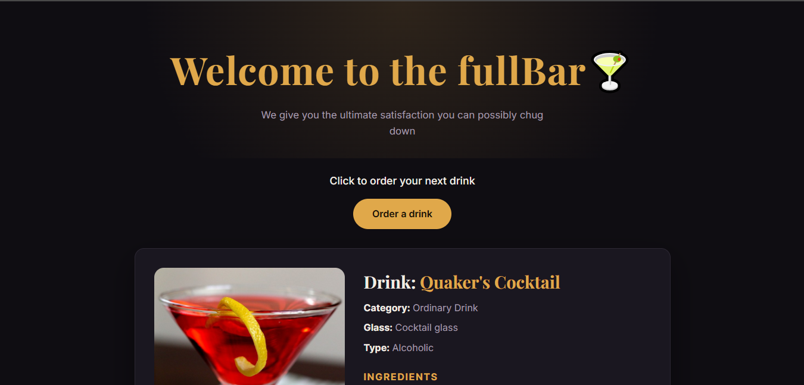

# fullBar 🍸

A simple web app that serves you a random cocktail. Built as a capstone project for the Complete Web Development Bootcamp using Node.js, Express, Axios and EJS.

Each time you click "Order a drink", the server fetches a random cocktail from [TheCocktailDB API](https://www.thecocktaildb.com/api.php) and shows its image, category, glass, ingredients and instructions.

# Screenshot


## Features
- Random cocktail on every request
- Ingredients list with measures
- Friendly error message if the API request fails
- Responsive dark-themed layout

## Tech Stack
- Node.js
- Express
- Axios
- EJS (templating)
- HTML and CSS


## Getting Started

### Prerequisites
- Node.js installed (v18 or newer recommended)
Installation

1. Clone the repository:
```bash```
   ```
   git clone <your-repo-url>
   cd <your-project-folder>
   ```

2. Install dependencies:

```bash```
```
   npm i
```
3. Start the server:
```bash```
```   
nodemon index.js
```

No nodemon? Use this instead:

```bash```
   ```
   node index.js
   ```
4. Open your browser at http://localhost:4000

## Project Structure
```
├── index.js              # Express server and API call
├── package.json
├── public/
│   └── styles/
│       └── main.css      # Styling
└── views/
    ├── index.ejs         # Main page
    └── partials/
        ├── header.ejs
        └── footer.ejs
```

## How It Works
1. The browser requests `/.`
2. The server uses Axios to call `https://www.thecocktaildb.com/api/json/v1/1/random.php.`
3. The first item in the `drinks` array is passed to `index.ejs.`
4. EJS renders the drink details. If the request fails, an error message is shown instead.

# API

Data comes from [TheCocktailDB](https://www.thecocktaildb.com/api.php). The free test key (`1`) is used, so no signup is needed.

# Future Improvements
- Search for a cocktail by name
- Filter by category or alcoholic / non-alcoholic
- Save favourite drinks

# Link
[Click to visit the website](https://fullbar.onrender.com)

# Author
Built by Isaiah Ayomide Yenou as a part of the Complete Web Development Bootcamp by Dr. Angela Yu.